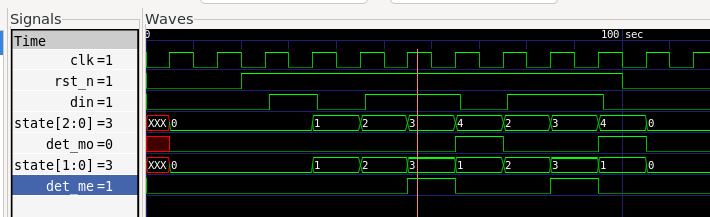
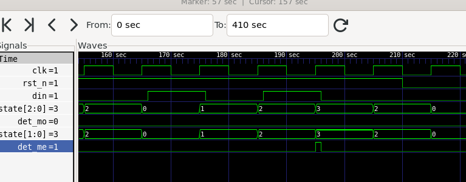

# 1011 검출기: Moore vs Mealy

## 사양
- 1011 검출기
- overlapping 허용
- 리셋 : Sync, Active low, 리셋 후 IDLE, det = 0
- 입력 : 1clk마다 din이 들어감
- Moore는 1011 검출 다음 clk, Mealy는 검출 즉시 det 신호 출력

## 첫 검출 구간

- 검출 시 Moore는 1clk 이후 state 4에서 det 출력
- 검출 시 Mealy는 즉시 state 3에서 det 출력

## 195~196 구간의 짧은 펄스

- Mealy에서 state 3에서 din이 #1동안 1인 시점에 짧은 펄스 출력
- TB에서 race를 예방해 @(posedge clk); #1 이후 din을 변경해 생성됨
- TB에서 검출은 @(negedge clk); 이후 진행해 에러 감지 X

## 정리
- Moore 출력은 상태가 바뀌어야 출력
- Mealy 출력은 상태 또는 입력이 바뀌어야 출력

## 검증
- 기본값 : rst_n=0, din=0
1. 리셋                       -> 둘 다 IDLE, det=0 확인
2. 1 0 1 1 0 1 1 0           -> overlapping 검출 2번 Moore det 00001001 / Mealy det 00010010
3. 리셋 후 1 1 0 0 1 0 1 0 0  -> 검출 없음 (det 전부 0)
4. 리셋 후 1 0 1 1 1 0 0 0    -> 검출 1번, Moore S3에서 1 -> S0 확인
5. 끝                        -> err, checks 출력 (PASS/FAIL)
- RTL의 전이 하나를 일부러 틀리게 바꿨을 때 FAIL 확인